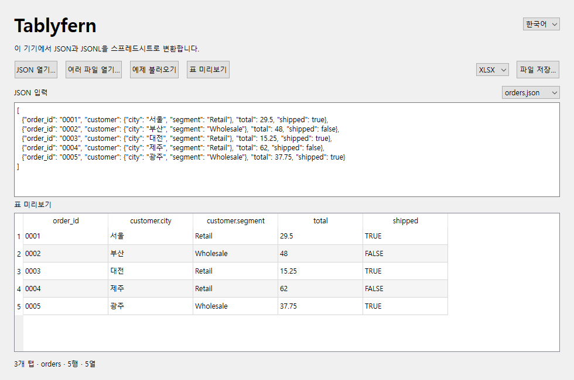

# Tablyfern

[English](README.md)

Tablyfern은 JSON과 JSONL을 시트 한 장이나 구분자 텍스트 파일로 변환하는 Windows 도구입니다. 입력 파일은 이 기기에서 처리됩니다.

대용량 처리와 **사용 한도** 창은 현재 소스에서 실행할 수 있습니다. v0.1.0 배포 ZIP은 입력 파일당 10 MiB 한도가 적용됩니다.

1. [GitHub 릴리스](https://github.com/hobby-programmer-5000/tablyfern/releases)에서 Windows x64 ZIP을 받아 전체 폴더를 압축 해제한 뒤 **Tablyfern.exe**를 실행합니다. EXE 옆의 `_internal` 폴더도 함께 둡니다. 소스에서 실행하려면 Python 3.12–3.14 환경에서 저장소 루트를 열고 `python -m pip install -r requirements.txt`를 실행한 뒤 `python app.py` 또는 [run.bat](run.bat)을 실행합니다.
2. 언어 메뉴에서 **한국어**를 선택합니다. **JSON 열기…**를 누르거나 편집기에 데이터를 붙여넣습니다. **예제 불러오기**로 시작할 수도 있습니다.
3. 내용을 편집했다면 **표 미리보기**를 누릅니다. 출력 형식을 선택하고 **파일 저장…**을 누르면 전체 표가 저장됩니다.

Windows 빌드는 시스템 Visual C++ 런타임을 사용합니다. Windows에서 `VCRUNTIME` 또는 `MSVCP` DLL을 찾지 못한다면 Microsoft의 [최신 지원 x64 Visual C++ 재배포 가능 패키지](https://learn.microsoft.com/en-us/cpp/windows/latest-supported-vc-redist/)를 설치하세요.

## 여러 파일을 통합 문서 하나로 저장하기

1. **여러 파일 열기…**를 눌러 JSON, JSONL 또는 NDJSON 파일을 선택합니다. 파일 선택 창에서 전달한 순서대로 파일 하나당 탭 하나가 만들어집니다.
2. JSON 입력 위의 메뉴에서 탭을 골라 미리 봅니다. 탭 이름에는 파일명을 쓰며, [Excel 탭 이름 규칙](https://support.microsoft.com/en-gb/excel/rename-a-worksheet)에 맞게 조정하고 이름이 겹치면 번호를 붙입니다.
3. XLSX, XLSM, XLTX, XLTM, ODS 중 하나를 골라 **파일 저장…**을 누르면 탭 전체가 함께 저장됩니다. CSV와 TSV는 파일 하나를 변환할 때 선택할 수 있습니다.

한 번에 최대 100개 파일을 선택할 수 있습니다. 읽거나 해석할 수 없는 파일이 있으면 파일명과 원인을 표시하고 이전 미리보기를 유지합니다. 다시 단일 입력을 편집하려면 **JSON 열기…**나 **예제 불러오기**를 누르세요.

## JSON을 표로 변환하는 규칙

- 객체 또는 객체 배열은 객체 하나당 한 행이 됩니다. 열은 필드가 처음 나타난 순서대로 정렬합니다. 중첩 객체에는 `profile.city`처럼 점으로 연결한 경로를 씁니다. 키 자체에 들어 있는 점과 역슬래시는 이스케이프하고, 빈 키는 `\0`으로 표시합니다.
- 단일 값이나 객체가 아닌 항목을 포함한 배열은 `value` 열 하나를 사용합니다. 레코드 안의 배열과 필드 값으로 들어 있는 빈 객체는 압축된 JSON 텍스트로 저장합니다. 누락된 필드와 null은 빈 셀이 됩니다.
- 엑셀의 범위와 유효 숫자 15자리 이내로 표현할 수 있는 숫자는 숫자 셀이 됩니다. 그 외 숫자는 원래 표기를 텍스트로 보존합니다. `=`로 시작하는 문자열도 텍스트로 저장합니다.
- JSONL과 NDJSON은 줄마다 레코드 하나를 읽으며 배열 한 줄도 레코드 하나로 취급합니다. 빈 줄은 오류입니다. **입력 자동 감지**는 일반 JSON을 먼저 읽으므로, 배열 한 줄을 JSONL 레코드로 붙여넣을 때는 **JSONL**을 선택하세요.

## 파일 및 시트 한도

앱의 **사용 한도**에서도 같은 수치를 확인할 수 있습니다. UTF-8 `.json`, `.jsonl`, `.ndjson` 입력에는 고정 파일 크기 한도가 없습니다. 1 GiB 파일도 레코드와 시트가 한도에 맞고 임시 폴더와 저장 위치에 여유 공간이 있으면 변환할 수 있습니다. 행과 열이 한도 안이어도 통합 문서 패키지가 내부 크기 한도에 먼저 도달할 수 있습니다. [XlsxWriter 패키지 한도](https://xlsxwriter.readthedocs.io/exceptions.html#exception-filesizeerror)

Windows x64에서 1,073,745,005바이트짜리 가상 JSONL을 XLSX로 저장하고 다시 읽어 데이터 65,445행과 2열의 값을 확인했습니다. 테스트는 반복 텍스트가 들어 있는 2열 표로 진행했습니다. 출력 파일 크기와 처리 시간은 입력에 따라 달라집니다.

| 항목 | 한도 |
| --- | --- |
| 디스크로 처리하는 레코드 | JSON 배열 항목 하나, JSONL·NDJSON 한 줄 또는 단일 JSON 객체나 값마다 16,777,216자 |
| 시트 | 파일 하나당 시트 한 장. 머리글 외 데이터 1,048,575행과 이어지는 열을 포함해 16,384열 |
| 셀 텍스트 | UTF-16 32,767단위 또는 줄바꿈 253개를 넘는 입력은 `text [part 2]`처럼 옆 열로 나눕니다. 열 순서대로 이어 붙이면 원래 값을 복원할 수 있습니다. |
| 편집기와 미리보기 | 붙여넣기 10 MiB, 미리보기 최대 50행과 40열 |
| 여러 파일과 구분자 출력 | 한 번에 최대 100개 파일. CSV와 TSV는 표 하나를 지원하며 머리글을 포함해 1,000만 셀까지 저장합니다. |

[Excel 사양 및 한도](https://support.microsoft.com/en-us/excel/excel-specifications-and-limits)

## 출력 형식

| 형식 | 저장 결과 |
| --- | --- |
| `.xlsx` | 표준 Excel 통합 문서 |
| `.xlsm` | 데이터만 들어 있는 매크로 지원 통합 문서 형식 |
| `.xltx` | Excel 템플릿 |
| `.xltm` | 데이터만 들어 있는 매크로 지원 템플릿 형식 |
| `.ods` | OpenDocument 스프레드시트. XML에 쓸 수 없는 문자가 있으면 해당 셀 위치를 표시합니다. |
| `.csv`, `.tsv` | BOM을 포함한 UTF-8. Excel이 열 때 셀 유형을 자동으로 추정할 수 있습니다. 수식처럼 보이는 텍스트 앞에는 작은따옴표를 붙입니다. 표 크기는 1,000만 셀까지입니다. |

`.xls` 또는 `.xlsb`가 필요하면 `.xlsx`로 저장한 후 데스크톱 Excel의 **다른 이름으로 저장**을 사용하세요. Excel에서 셀 유형, 앞자리 0, 긴 숫자 ID를 보존해야 한다면 통합 문서 형식을 사용하세요. [Microsoft 파일 형식 안내](https://support.microsoft.com/en-us/excel/file-formats-that-are-supported-in-excel)

## 가상 입력으로 호환성 확인

- 직접 만든 [가상 샘플](samples/README.md)로 시작할 수 있습니다. `python fixtures.py .cache/fixtures`를 실행하면 별도 폴더에 가상 입력 35개가 생성됩니다.
- 앱 의존성과 테스트용 읽기 라이브러리 `openpyxl==3.1.5`를 설치하고 `python verify_formats.py .cache/matrix`를 실행합니다. 결과표 `matrix.md`와 `batch-matrix.md`에서 단일 파일 및 32탭 통합 문서 검증을 확인할 수 있습니다. [openpyxl 3.1.5](https://pypi.org/project/openpyxl/3.1.5/)
- Windows x64에서 빌드하려면 [requirements-build.txt](requirements-build.txt)를 설치하고, 새 출력 폴더를 지정해 `python scripts/build.py --dist-dir dist/0.1.0`을 실행합니다. 스크립트가 빌드된 앱을 실행해 확인하고 ZIP과 SHA-256 체크섬을 생성합니다.

## 라이선스

앱 원본 코드와 샘플에는 [MIT](LICENSE)를 적용합니다. 함께 제공하는 구성 요소는 각자 라이선스를 따릅니다. [제3자 고지](THIRD-PARTY-NOTICES.ko.md) · [기여자](CONTRIBUTORS.ko.md)
