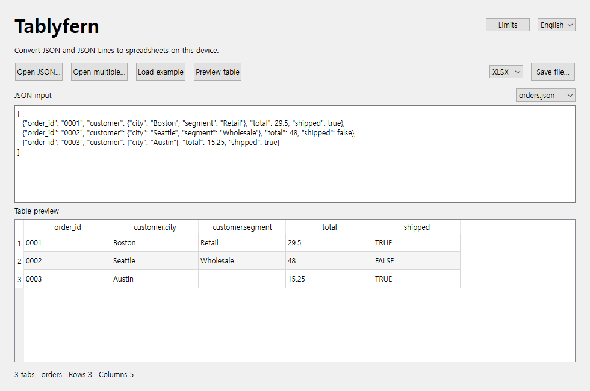

# Tablyfern

[한국어](README.ko.md)

Tablyfern is a local Windows tool that converts JSON and JSON Lines into one worksheet or delimited table.

Large-file support and the **Limits** dialog are available when running the current source. The v0.1.0 ZIP has a 10 MiB input file limit.

1. Download the Windows x64 ZIP from [GitHub Releases](https://github.com/hobby-programmer-5000/tablyfern/releases), extract the entire folder, and open **Tablyfern.exe**. Keep its `_internal` folder beside the EXE. From source, use Python 3.12–3.14, run `python -m pip install -r requirements.txt` from the repository root, then run `python app.py` or double-click [run.bat](run.bat).
2. Click **Open JSON…**, paste data into the editor, or try **Load example**. Choose **JSONL** for pasted data when each line should be a separate record. Use the language menu to switch to Korean.
3. Click **Preview table** after editing. Pick an output format and use **Save file…** to export the full table.

The Windows build uses the system Visual C++ runtime. If Windows reports a missing `VCRUNTIME` or `MSVCP` DLL, install Microsoft's [latest supported x64 Visual C++ Redistributable](https://learn.microsoft.com/en-us/cpp/windows/latest-supported-vc-redist/).

## Put several files in one workbook

1. Click **Open multiple…** and select JSON, JSONL, or NDJSON files. Each file becomes its own tab, in the order returned by the file picker.
2. Use the menu above the source text to preview each tab. Tablyfern takes tab names from filenames, adjusts them to fit [Excel's tab-name rules](https://support.microsoft.com/en-gb/excel/rename-a-worksheet), and adds suffixes when names collide.
3. Choose XLSX, XLSM, XLTX, XLTM, or ODS and click **Save file…** to save all tabs together. CSV and TSV are available for single-file exports.

One selection can contain up to 100 files. If a file cannot be read or parsed, Tablyfern identifies it and keeps the previous preview. To return to editing one input, use **Open JSON…** or **Load example**.

## How JSON maps to Excel

- An object or an array of objects becomes one row per object. The fields become columns in order of first appearance. Nested objects use dotted paths such as `profile.city`. Literal dots and backslashes in keys are escaped, and an empty key displays as `\0`.
- A scalar, or an array containing any non-object value, uses a single `value` column. Arrays inside a record and empty objects used as field values stay as compact JSON text. Missing fields and nulls become blank cells.
- Numbers representable within Excel's range and 15 significant digits become numeric cells. Other numbers retain their original JSON spelling as text. Strings that start with `=` stay text.
- JSONL and NDJSON treat each line as one record, including an array on a single line. Blank lines are input errors. **Detect input** tries ordinary JSON first, so choose **JSONL** explicitly for a single line containing an array.

## File and worksheet limits

Open **Limits** in the app for the same figures. UTF-8 `.json`, `.jsonl` and `.ndjson` files have no fixed input size cap. A 1 GiB file can convert if its records and worksheet fit and the temporary and output drives have sufficient free space. Workbook packages can reach an internal size limit before the row or column limit. [XlsxWriter package limits](https://xlsxwriter.readthedocs.io/exceptions.html#exception-filesizeerror)

Verified on Windows x64 with a synthetic 1,073,745,005-byte JSONL file. The XLSX reopened with all 65,445 data rows and both columns intact. That test used repetitive text and a narrow table. Export size and runtime depend on the input.

| Item | Limit |
| --- | --- |
| A disk-processed record | 16,777,216 characters per JSON array item, JSONL/NDJSON line, or standalone JSON object or value |
| Worksheet | One per input file. 1,048,575 data rows plus the header and 16,384 columns, including continuation columns. |
| Cell text | Imported text beyond 32,767 UTF-16 units or 253 line feeds continues in adjacent columns such as `text [part 2]`. Join parts in column order to reconstruct the value. |
| Editor and preview | Paste up to 10 MiB. Preview up to 50 rows and 40 columns. |
| Batch and delimited output | Up to 100 files per batch. CSV and TSV support one table and 10,000,000 cells, including headers. |

[Excel specifications and limits](https://support.microsoft.com/en-us/excel/excel-specifications-and-limits)

## Output formats

| Format | Result |
| --- | --- |
| `.xlsx` | Standard Excel workbook |
| `.xlsm` | Macro-enabled workbook format with data only |
| `.xltx` | Excel template |
| `.xltm` | Macro-enabled template format with data only |
| `.ods` | OpenDocument spreadsheet. Text containing XML-incompatible characters is rejected with a cell location. |
| `.csv`, `.tsv` | UTF-8 with BOM. Excel may infer its own data types when opening the file. Formula-like text gets a leading apostrophe. The grid is limited to 10 million cells. |

For `.xls` or `.xlsb`, export `.xlsx` and use **Save As** in desktop Excel. Use a workbook format when you need to preserve typed cells, leading zeros or long numeric IDs in Excel. [Microsoft file format reference](https://support.microsoft.com/en-us/excel/file-formats-that-are-supported-in-excel)

## Synthetic compatibility checks

- Start with the original synthetic [sample data](samples/README.md). Run `python fixtures.py .cache/fixtures` to generate 35 additional synthetic inputs in a new directory.
- With the app dependencies and the test reader `openpyxl==3.1.5` installed, run `python verify_formats.py .cache/matrix`. See `matrix.md` and `batch-matrix.md` for single-file and 32-tab workbook checks. [openpyxl 3.1.5](https://pypi.org/project/openpyxl/3.1.5/)
- To build on Windows x64, install [requirements-build.txt](requirements-build.txt) and run `python scripts/build.py --dist-dir dist/0.1.0` into a new directory. The script tests the frozen app and writes a ZIP and SHA-256 checksum.

## Licenses

Original source and samples use [MIT](LICENSE). Bundled components retain their own terms. [Third-party notices](THIRD-PARTY-NOTICES.md) · [Contributors](CONTRIBUTORS.md)
